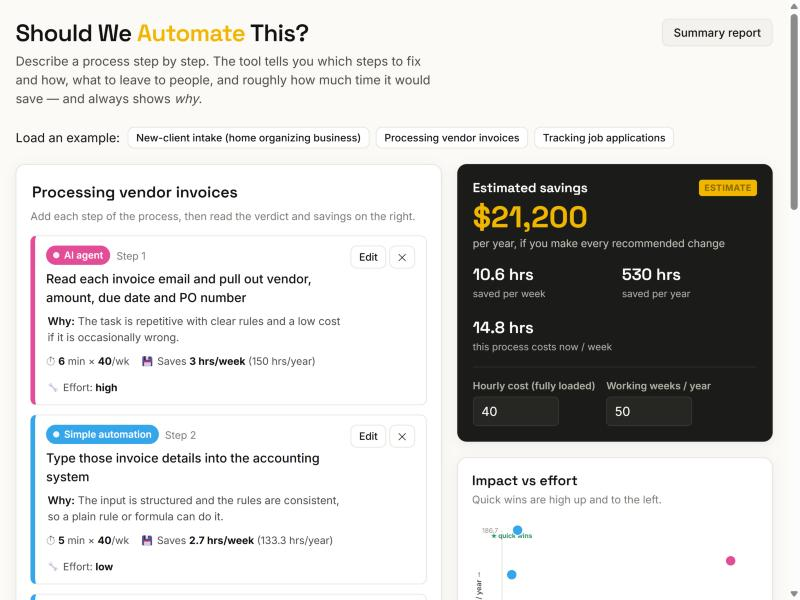

# Should We Automate This?

A transparent, rules-based tool that analyzes a work process **step by step** and tells you
which steps to fix and how — eliminate, simple automation, build a small app, AI assist,
AI agent, or keep human — how much time each change could save, and **always shows _why_**.

It's the time study and process analysis a consultant does, turned into a tool you can use in five minutes.

👉 **Live demo:** _add your Vercel URL here after deploying (see "Deploy" below)._



---

## Why this exists

Teams usually know _some_ work is slow, but not **which** steps are worth fixing or **how**.
"Automate everything" is wrong (relationships and judgment calls shouldn't be automated), and
so is "it's fine" (people quietly lose hours to copy-paste busywork). This tool makes the
trade-off explicit and defensible: every recommendation comes with the exact reasons behind it,
and every time/money figure is a labeled estimate with assumptions you can change.

## What it does

- **Process builder** — name a process and add steps. Each step captures what happens, minutes
  per run and runs per week, the type of work, whether the input is structured or messy, where
  the information lives, how clear the rules are, the cost of a mistake, and whether the step is
  even needed.
- **A recommendation per step**, from a clear scoring model, with a one-line **"Why"**:
  - **Eliminate** — the step doesn't need to exist.
  - **Simple automation** — a rule, formula, form, or a tool like Zapier / Power Automate.
  - **Build a simple app** — the real problem is a missing system (scattered info + re-entry).
  - **AI assist** — AI drafts, a person reviews.
  - **AI agent** — AI handles it end-to-end, a person spot-checks.
  - **Keep human** — judgment, relationships, or high risk.
- **Impact** — hours saved per week and per year, per step and in total, plus a dollar value
  from an hourly cost you set.
- **Effort estimate** per step and an **impact-vs-effort chart**, so quick wins jump out.
- **"Do these first"** — a ranked list by best payoff per effort.
- **One-page summary report** you can print to PDF or copy as text.
- **Three example processes** you can load in one click.
- **Saves to your browser** (localStorage) so nothing is lost on refresh.

Everything runs **in the browser**. No backend, no API keys, no paid services, nothing leaves your device.

---

## How the scoring works (the important part)

All decision logic lives in one small, heavily-commented file: [`src/scoring.js`](src/scoring.js).
There is **no machine learning and no hidden model** — just a set of transparent, ordered rules
that mirror how a consultant reasons. Reading that file top to bottom tells you everything.

**1. Raw inputs become named signals** (e.g. `isScattered`, `isHighRisk`, `isReentry`,
`isDeterministic`). Naming each condition makes the rules read like plain English.

**2. Ordered rules, first match wins** (like triage). The order encodes the priorities
_eliminate → fix the system → protect humans → automate_:

| # | Rule | Fires when | Result |
|---|------|-----------|--------|
| 1 | Eliminate | step marked "not needed" | **Eliminate** |
| 2 | No system | info scattered **and** people re-enter it by hand | **Build a simple app** |
| 3 | Relationships | the step is talking to a customer | **Keep human** |
| 4 | Risky judgment | judgment call where rules vary or a mistake is costly | **Keep human** |
| 5 | Unspecifiable risk | high mistake cost **and** rules not consistent | **Keep human** |
| 6 | Mechanical & clear | structured input + consistent rules + move/check-data task + not high-risk | **Simple automation** |
| 7 | Safe to hand off | repetitive + clear rules + **low** risk | **AI agent** |
| 8 | Needs review | language/messy work where a mistake matters | **AI assist** |
| — | Fallback | nothing else matched | **AI assist** (draft + review) |

**3. Effort** starts from a base per recommendation type and goes up for things that genuinely
add work: scattered systems, messy input, and high stakes (more testing/guardrails).

**4. Impact** = `minutes × runs/week × fraction removed`. The "fraction removed" is a documented
assumption per verdict (Eliminate 100%, Simple automation 80%, AI agent 75%, Build app 70%,
AI assist 40%, Keep human 0%), shown to the user in the legend — never a hidden number. Yearly
figures use your editable hourly cost and working-weeks-per-year.

Because every rule returns its reasons, the UI can always answer "why did it say that?".

### Tests

The rules are covered by unit tests in [`src/scoring.test.js`](src/scoring.test.js) — one test
per rule, so the tests double as documentation of the intended behavior.

```bash
npm test
```

---

## Run it locally

```bash
npm install
npm run dev      # start the dev server (prints a localhost URL)
npm test         # run the scoring unit tests
npm run build    # produce the static site in dist/ (what Vercel deploys)
```

Requires Node 18+. There is nothing else to configure — no environment variables, no keys.

## Deploy (free, on Vercel)

This is a static Vite site, so hosting is free:

1. Push this repo to GitHub (already done if you're reading this there).
2. Go to [vercel.com](https://vercel.com) and sign in with GitHub.
3. **Add New → Project**, import `should-we-automate-this`.
4. Vercel auto-detects Vite. Confirm **Build Command** `npm run build` and **Output Directory**
   `dist`, then **Deploy**.
5. Copy the live URL into the "Live demo" line near the top of this README.

---

## How it's built

- **Vite + React** — a standard, fast toolchain; the build is a plain static site.
- **No UI or chart libraries** — the impact-vs-effort chart is hand-drawn SVG, so there are no
  dependencies to explain and the math is fully visible.
- **Clean separation of concerns** — `src/scoring.js` is pure logic (no React), the components
  are presentation only. You can reason about the decision engine and the UI independently.

```
src/
  scoring.js        ← the decision engine (read this first)
  scoring.test.js   ← one unit test per rule
  examples.js       ← the three sample processes
  App.jsx           ← state + layout, no decision logic
  components/        ← StepCard, SavingsPanel, ImpactEffortChart, DoFirst, Legend, SummaryReport
  lib/               ← localStorage + formatting helpers
```

## What I'd add next (v2)

- **Describe a process in plain English** and have an AI turn it into steps (via MCP, locally),
  so you don't have to add each step by hand.
- **Before/after tracking** — enter the real time after automating a step to measure _actual_
  savings against the estimate, so the tool learns how good its assumptions were.
- **Confidence on each verdict** — surface how close a step was to a different recommendation.
- **Shareable links** — encode a process into the URL so a colleague can open the same analysis.
- **Tune the assumptions** — let the user edit the "fraction removed" per verdict, not just the hourly cost.

## Notes & limitations

- All time and money numbers are **estimates** meant to support a conversation, not a precise forecast.
- The rules are deliberately simple and opinionated so they can be explained and defended. They're
  a starting point for discussion, not the final word — a person should still sanity-check each verdict.
